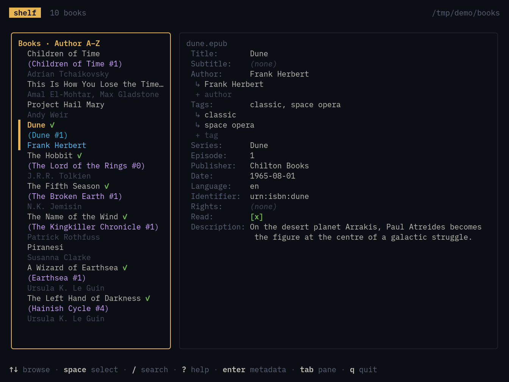
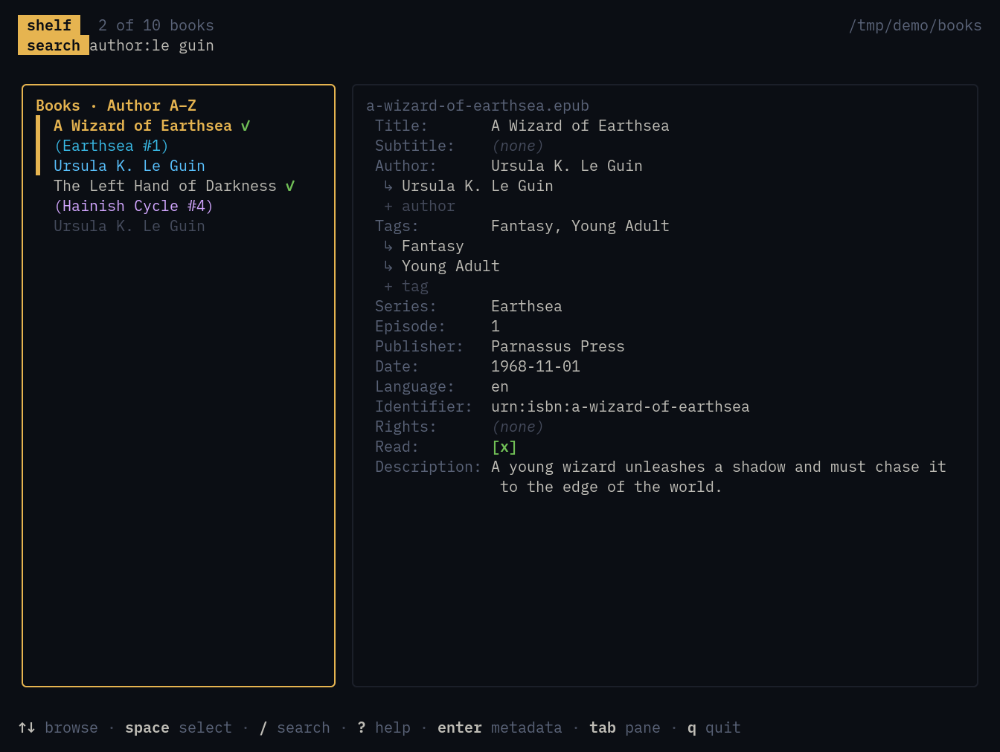
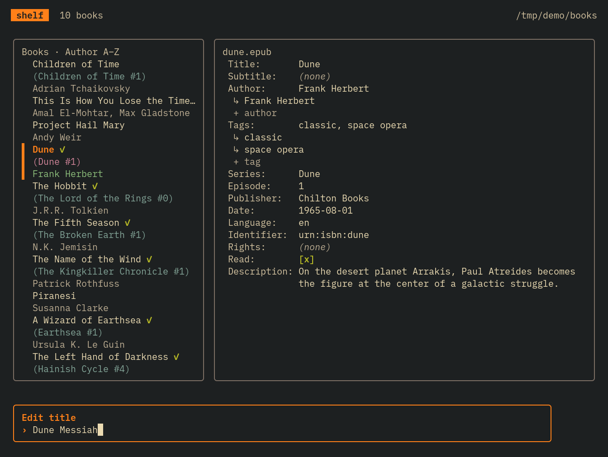
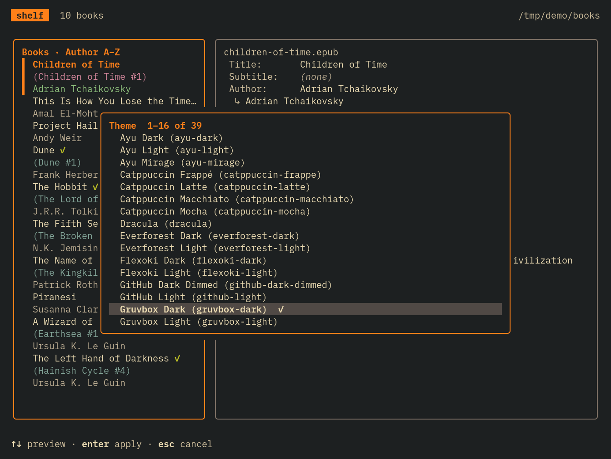

# shelf

`shelf` manages the metadata of EPUB files from the terminal. It is written in
Rust, with a [ratatui](https://ratatui.rs) interface and
[opaline](https://crates.io/crates/opaline) themes. It has two faces:

- a **TUI** that lists every EPUB on a shelf and lets you view and edit each
  Dublin Core field in place, and
- a **CLI** for reading fields and applying batch edits across many files at
  once.

Both share one editing engine of shelf's own. Reads extract only the package
document from the EPUB, so scanning a shelf never decompresses the books' images
or chapters. A save patches just the changed metadata elements in the package
document and copies every other archive entry in compressed form: untouched
metadata keeps its original bytes (including author `opf:role`/`opf:file-as`
attributes, EPUB 3 refinements, comments and ordering), and chapters, images and
the cover are never re-compressed. A save is minimal: only replacing a creator,
title or tag list drops that element's refinements.

## Screenshots

Browse the shelf and see the selected book's metadata, in `ayu-dark`:



Filter with free text or a field prefix such as `author:`:



Edit a field in place, in `gruvbox-dark`; `enter` saves and `esc` cancels:



Press `ctrl+t` for the theme selector, which previews every opaline theme on
the shelf behind it before `enter` applies one:



## Install

```sh
cargo install --path .
# or build from source
cargo build --release   # binary at target/release/shelf
```

## Configuration

shelf reads an optional TOML file from
`$XDG_CONFIG_HOME/shelf/config.toml`, or `~/.config/shelf/config.toml` when
`XDG_CONFIG_HOME` is unset. To use a default library, set it explicitly:

```toml
library = "/path/to/books"
viewer = "zathura"
sort = "title"
theme = "gruvbox-dark"
search_url = "https://www.google.com/search?q=%a+%t"
google_books_api_key = "your-google-books-api-key"
rename_format = "%a - %t.epub"
slugify = true
```

There is no built-in library directory: when `library` is unset, or the config
file is missing, shelf uses the current working directory. The TUI and batch
commands use the configured library when no file or directory is given on the
command line. An explicit path or `-C DIR` takes precedence. A leading `~` in
`library` is expanded to the home directory.

`viewer` is an optional command used by `ctrl+o` in the TUI. When it is not
set, `ctrl+o` does nothing. It may include arguments
(`viewer = "calibre-ebook-viewer --detach"`); the command is looked up on
`PATH` (or use an absolute path), and the selected EPUB path is appended as the
final argument.

`search_url` is opened in the system's default browser with `ctrl+k`. It uses
the same placeholders as `rename_format`, e.g. `%a` for author, `%t` for title,
`%s` for series, `%i` for identifier and `%title`/`%author` for the long field
names. Values are URL-escaped. When the setting is absent, `ctrl+k` does
nothing.

`theme` selects the TUI color palette. Every theme that ships with opaline is
available by its id: `gruvbox-dark` is the default, and ids such as
`catppuccin-mocha`, `nord`, `tokyo-night` or `solarized-light` work too. An
unknown theme is reported as a configuration error at startup. Press `ctrl+t`
in the TUI to open the theme selector over the shelf: it lists every opaline
built-in theme, previews the highlighted one on the panes behind the pop-over
as you move and applies it with `enter`. The theme's canvas color (`bg.base`)
is painted across the whole terminal, so the shelf keeps its own background
instead of borrowing the terminal's.

`sort` sets the Books pane order at startup. Use `path` (the default), `title`,
`author`, `series`, `date` or `language`, optionally followed by a direction:
`sort = "title:desc"`, `sort = "date newest first"`, or `sort = "series-desc"`.
Separate several keys with commas for a composite order, for example
`sort = "author,series"` sorts by author and then by series and episode. Each
key can have its own direction: `sort = "author:asc,series:desc"`. Ascending is
the fallback when no direction is given.

`google_books_api_key` is optional. The online lookup uses it for Google Books
requests and raises the quota substantially. Unauthenticated requests can
return `429 Too Many Requests`; create a key in Google Cloud with the Books API
enabled and put it here. When the setting is absent, shelf makes unauthenticated
requests.

`rename_format` sets the default pattern for `shelf rename`. It is used when
`-f/--format` is not given; an explicit `-f` always wins.

`slugify = true` makes slugified names the default for `shelf rename`.
`--no-slugify` (or the `--no-sluggify` alias) disables it for one run, and
`--slugify`/`-s` forces it on. The `sluggify` spelling is also accepted for the
config key.

## TUI

Run it in a directory of EPUBs, or point it at one:

```sh
shelf            # browse the configured library (or the current directory)
shelf ~/books    # browse a shelf
shelf dune.epub  # jump straight into editing a single book
```

Two panes sit side by side (they stack vertically below 84 columns): **Books**
on the left, and the **Metadata** of the selected book on the right.

```
 shelf   3 books                                                 ~/books

╭────────────────────────────╮ ╭──────────────────────────────────────────╮
│ Books · File path A–Z      │ │ dune.epub                                │
│ ▌ Dune                     │ │  Title:       Dune                       │
│   (Dune #1)                │ │  Subtitle:    (none)                     │
│   Frank Herbert            │ │  Author:      Frank Herbert              │
│   The Hobbit               │ │   ↳ Frank Herbert                        │
│   …                        │ │   + author                               │
│                            │ │  Tags:        Science Fiction            │
│                            │ │   ↳ Science Fiction                      │
│                            │ │   + tag                                  │
│                            │ │  Series:      Dune                       │
│                            │ │  Episode:     1                          │
│                            │ │  Publisher:   Chilton                    │
╰────────────────────────────╯ ╰──────────────────────────────────────────╯

↑↓ browse · space select · / search · ? help · enter metadata · tab pane · q quit
```

Authors and tags are shown as one row each (`↳`), with a `+ add` row below
the group. Books with series information get a line between the title and
author, e.g. `(Dune #1)` or `A Novel (Dune #1)`. Press `tab` to switch panes,
`/` to filter the list, and `ctrl+d` / `ctrl+u` to page through a pane. Long
descriptions wrap across multiple lines in the metadata pane.

Search terms can be combined and all of them must match. Each term is either an
unprefixed word searched across the title, authors, series, tags, description
and file name, or a field prefix such as `title:dune`, `author:herbert` or
`read:no`. For example, `test read:no author:lol` finds unread books whose
author contains “lol” and that contain “test” anywhere. Prefixes are
case-insensitive and use the same field names and aliases as the CLI
(`creator`, `tags`, `series-index`, `isbn`, `summary`, …). `file:` matches the
EPUB file name and `path:` the full path. Without a value, a prefix lists the
books that have that field set, e.g. `tags:` finds every book with at least one
tag and `series:` every book in a series. Read status has its own filters:
`read:` lists read books, `read:yes` and `read:true` do the same, while
`read:no`, `read:false` and `read:unread` list unread books. Quote a value with
spaces, e.g. `author:"le guin"`. Press `u` to show only unread books or `U` to
show only read books; press the same key again to clear the filter. The
read-status filter combines with the search query.

Queries also support operators:

- Prefix a term with `-` to negate it: `-read:yes`, `-tag:fantasy`.
- Join alternatives with `OR`: `tag:fantasy OR tag:scifi`.
- Compare a field with `=`, `!=`, `<`, `<=`, `>` or `>=`:
  `date:>=1980`, `series-index:>=2`, `language:=en`.

AND binds tighter than OR, so `author:herbert read:no OR title:dune` means
“unread books by Herbert, or books titled Dune”.

| Key | Action |
| --- | --- |
| `↑`/`↓` or `j`/`k` | move |
| `J` / `K` | jump to the next / previous book of a different series or author |
| `ctrl+d` / `ctrl+u` (or `pgdn`/`pgup`) | page down / up |
| `space` | select / deselect the book under the cursor, then move down |
| `ctrl+a` | select all books currently visible (after the search filter) |
| `/` | search the shelf, optionally with a field prefix such as `title:` or `author:` |
| `u` / `U` | filter to unread / read books only |
| `tab` / `shift+tab` | switch pane |
| `e` / `enter` | edit the field under the cursor |
| `a` / `n` | add an author or tag |
| `d` / `delete` | delete the author or tag under the cursor |
| `D` | delete the selected book(s), after confirmation |
| `S` | choose the Books sort order |
| `ctrl+o` | open the book under the cursor in the configured viewer |
| `ctrl+k` | open the configured `search_url` in the default browser |
| `ctrl+t` | open the theme selector (preview with `↑`/`↓`, `enter` applies) |
| `?` | open the keyboard help dialog |
| `R` | rescan the directory |
| `r` | repair the selected book when its metadata could not be read |
| `m` | look up metadata online for the selected book |
| `x` | mark the selected book(s) read / unread |
| `N` | rename the selected book(s) using the configured rename settings |
| `M` | rename the selected book(s) and move them into the configured library |
| `esc` | close the editor / clear the selection / clear the search / go back to the list |
| `q` | quit |

`D` deletes every book selected with `space`, or the book under the cursor when
nothing is selected. A confirmation dialog always appears first: `y`/`enter`
deletes, `n`/`esc` cancels.

Press `S` to choose the Books sort order: file path, title, author, series,
date or language, ascending or descending (oldest or newest first for dates).
Within a series, books are ordered by episode number before title. Use `↑`/`↓`
or `j`/`k` to move, `enter` to apply and `esc` to cancel. The cursor stays on
the same book after sorting.

When a book's metadata cannot be read, the detail pane offers `r repair`. That
runs the same package-XML repair as the `shelf repair` command and reloads the
book afterwards.

Press `N` to rename the selected book(s) using the configured `rename_format`
and `slugify` settings. With no multi-selection, it renames the book under the
cursor. Existing files are not overwritten; skipped renames are reported in the
status line.

Press `M` to rename the selected book(s) with `rename_format` and move them into
the configured `library`. This action is only available when both `library` and
`rename_format` are set in the configuration; it never falls back to the
built-in `author - title` name. Books already inside the library are left where
they are, and an existing file in the library is never overwritten. With no
multi-selection, it moves the book under the cursor.

Press `m` to search Google Books for the selected book. shelf uses the existing
ISBN when available, otherwise the title and author. A dialog compares the
current metadata with the online result: `space` toggles a field, `a`/`n`
select all or none, `enter` applies the selected fields to the EPUB and `esc`
cancels. All offered fields are listed at once, with the current and online
values side by side; longer values wrap within their columns. Only fields with
a non-empty online value that differs from the current metadata are offered.
This sends the selected book's metadata to Google Books. Set
`google_books_api_key` in the config to avoid the unauthenticated quota and
`429` responses.

In the editor, `enter` saves and `esc` cancels. The description uses a
multi-line box: long text wraps inside the box, `enter` inserts a newline and
`ctrl+s` saves. Several authors can be added at once separated by `;`.

### Autocomplete

The author and series editors complete against every other book on the shelf.
Type a prefix and pick from the list: `tab` accepts the highlighted suggestion,
`↑`/`↓` (or `ctrl+p`/`ctrl+n`) move through it, and `esc` dismisses the list.

### Bulk editing

Press `space` on two or more books to multi-select them — selected books get a
`✓` in the list and the header counts them. With a bulk selection active, the
right pane becomes a **Bulk** editor over the seven fields that can be set across
many books at once: **author, tags, series, publisher, language, rights and
read status** (everything else stays per-book, so edit those one at a time).

A row shows the shared value when all selected books agree, or `(mixed)` when
they differ — editing a mixed row starts from an empty input, and only what you
type is written to every book. `e`/`enter` edits the field everywhere, `a`/`n`
appends an author or tag everywhere, and `d` clears the field everywhere. The
files are written one by one (`saving 1/3 …`) and the status line reports how
many books were saved. `esc` in the list drops the selection and returns to the
normal single-book view.

Read status is a custom field: press `x` to mark the book under the cursor
read, or every selected book when a multi-selection is active. `x` toggles the
whole selection back to unread when everything in it is already read. In the
metadata pane the field is a checkbox; `enter`, `e` or `space` toggles it, and
read books carry a `✓` at the end of their title in the book list. It is stored
as shelf's own namespaced `shelf:read` meta entry, never as an official Dublin
Core field. EPUB 3 books get a `property` meta plus the required prefix
declaration; EPUB 2 books use the legacy `name`/`content` form.

## CLI

### Read

```sh
shelf list ~/books              # human readable listing
shelf list --json ~/books       # machine readable
shelf list                      # the configured library (or current directory)
shelf get title book.epub       # one field
shelf get author *.epub         # many files, "path<TAB>value"
```

When no file or directory is given, `list` and `get` use the configured
library, falling back to the current directory.

Field names are case insensitive and accept aliases: `author`/`creator`,
`tags`/`subject`/`genre`, `series`, `series-index`/`episode`/`index`,
`description`/`summary`, `date`/`published`, `language`/`lang`,
`rights`/`copyright`, `identifier`/`isbn`/`id`, `read`/`read-status`/`finished`.

### Stats

`stats` summarizes a shelf: readable and unreadable files, read and unread
books, unique authors, series, tags and languages, total size on disk, and the
most common authors and series.

```sh
shelf stats ~/books
shelf stats -r --json ~/books
shelf stats --top 20 ~/books
```

### Edit

`set` only changes the fields you name. Arguments can be files or directories,
and `-r` recurses. With no path, `set` uses the configured library (or the
current directory).

```sh
shelf set -a 'Frank Herbert' dune.epub
shelf set --tags 'scifi, classic' -l en ~/books -r
shelf set --series Dune --series-index 1 dune.epub
shelf set --title '' book.epub            # clear a field
shelf set --read yes dune.epub            # mark a book read
shelf set -a 'Ursula K. Le Guin' --append fantasy/*.epub
shelf set -n --title 'Dune' dune.epub     # preview with --dry-run
```

| Flag | Meaning |
| --- | --- |
| `--title`, `--subtitle` | single-value fields (last one wins) |
| `-a, --author` | authors; repeatable, or separate several with `;` |
| `--tags` | subjects, comma separated |
| `--series` | series/collection name (Calibre `calibre:series`, plus EPUB 3.3 `belongs-to-collection` on EPUB 3 files) |
| `--series-index` | the book's number within its series (Calibre `calibre:series_index`, plus EPUB 3.3 `group-position`) |
| `-d, --description`, `--publisher`, `--date`, `-l, --language`, `--rights`, `--isbn` | the remaining fields |
| `--read` | mark read/unread (`yes` or `no`) |
| `--append` | append to multi-valued fields instead of replacing |
| `-n, --dry-run` | show what would change without writing |
| `-r, --recursive` | recurse into directories |
| `-C, --dir` | operate on a directory for this run, overriding the configured library |

Every batch command takes `-C DIR` so you can run it over a whole shelf without
spelling out paths. With no files or `-C`, commands use the configured library,
falling back to the current directory.

### Modify

`modify` applies a regular expression to the existing values of the fields you
select. Field flags work like `set`, but are switches here:

```sh
shelf modify --title -e 'Dune' --replacement 'DUNE' dune.epub
shelf modify --tags -e '^sf$' --replacement 'Science Fiction' -r ~/books
shelf modify --author -e '\bUrsula\b' --replacement 'Ursula K.' dune.epub
```

`-e, --regex` is required; `--replacement` defaults to empty, which deletes
matched text. The replacement supports `$1` and `${name}` expansion.
Authors and tags are modified individually. Values that do not match are left
alone, and a run with no matches does not rewrite the file. One expression is
applied to every selected field.

### Rename

`rename` renames files after the book they contain, so a shelf downloaded from
various sources becomes readable in a file manager. With no path, it uses the
configured library (or the current directory). If `-f` is omitted, it uses
`rename_format` from the configuration file when set, otherwise the built-in
`author - title` name. If `slugify = true` is configured, names are slugified
by default; `--no-slugify` turns that off for one run.

```sh
shelf rename ~/books/hobbit.epub     # -> Tolkien, J. R. R. - The Hobbit.epub
shelf rename -n -r ~/books           # preview a whole shelf
```

With `--format` (`-f`) the new name comes from a pattern of placeholders that
are replaced with the book's metadata:

```sh
shelf rename -f '%a - %t.epub' ~/books         # author - title
shelf rename -f '%s %e - %t.epub' ~/books      # series episode - title
shelf rename -f '%title (%d).epub' dune.epub   # field names work too
```

| Placeholder | Field | Placeholder | Field |
| --- | --- | --- | --- |
| `%t` | title | `%b` | subtitle |
| `%a` | author | `%g` | tags |
| `%s` | series | `%e` | episode (series index) |
| `%p` | publisher | `%d` | date |
| `%l` | language | `%r` | rights |
| `%i` | identifier | `%` | a literal percent |

Field names are the same as for `set` and `get` (`%title`, `%series-index`,
`%isbn`, ...). Episode numbers ending in `.0` are shortened (`2.0` → `2`);
fractional values are kept (`2.5`, or `2-5` with `--slugify`). Every value is
made safe for file names — path separators included — empty fields expand to
nothing, and `.epub` is appended when the pattern does not already end with it.
A bad placeholder aborts the run before any file is renamed.

With `--slugify` (`-s`; `--sluggify` is accepted as an alias), metadata
values are lowercased and converted to ASCII slugs: spaces become dashes, `ü`
becomes `ue`, `ß` becomes `ss`, accents are folded (`é` → `e`), and
punctuation is converted or removed.

```sh
shelf rename --slugify ~/books
shelf rename --slugify -f '%a-%t.epub' ~/books
# Jürgen Müller, Straße -> juergen-mueller-strasse.epub
```

The default `author - title` name uses a single dash between the fields when
slugifying. In `--format` patterns, only the metadata values are slugified;
literal punctuation is kept as written, while whitespace in the pattern becomes
a dash.

### Repair

`repair` exists for books damaged by older shelf releases. Those saves could
rewrite Dublin Core metadata using a default XML namespace instead of the
conventional `dc:` prefix. Most readers still parse that as XML, but readers
that look metadata up by qualified name (for example
`getElementsByTagName("dc:title")`) find nothing. Repair rewrites the package
document with the standard prefixes:

```sh
shelf repair ~/books/dune.epub
shelf repair -n -r ~/books     # preview a whole shelf
```

Metadata values are not changed, and files that already use `dc:` prefixes are
left untouched. It also repairs the mismatched `</dc:meta>` closing tags and
duplicate name/property meta keys written by older shelf versions. Current
writes are already clean, and reading tolerates duplicate keys, so repair is a
one-time migration rather than part of the normal edit flow. `-n` previews and
`-r` recurses.

### Check

`check` validates metadata and archive structure and reports one line per
problem:

```sh
shelf check ~/books
shelf check -r --json ~/books
shelf doctor ~/books          # alias
```

It checks for unreadable books, missing titles or authors, invalid languages,
dates and episode numbers, series/index inconsistencies, duplicate ISBNs, and
suspicious archives such as a missing or misplaced `mimetype`, a missing
container document or no package document. It exits non-zero when issues are
found.

### Completions and man pages

```sh
shelf completion bash        # also zsh, fish, powershell
shelf man                    # root man page to stdout
shelf man --dir man/         # pages for every command
```

## Design notes

- **Minimal in-place editing.** `src/epub` reads metadata directly from the
  EPUB ZIP, decompressing only `META-INF/container.xml` and the package
  document. A save edits the metadata block of the package document in place
  and copies every other entry in compressed form; the file is replaced
  atomically (the original file mode is preserved, and a failed write can never
  truncate the book). Untouched elements keep their exact bytes, so namespace
  prefixes, unknown attributes, refinements and comments survive. The archive
  is never fully decompressed into memory.
- **Byte-span XML edits.** The package document is parsed with
  `quick-xml` while recording the byte span of every metadata child, so an edit
  splices only the changed elements instead of re-serializing the document.
- **Calibre and EPUB 3.3 aware.** Series and episode number are written both as
  the Calibre `calibre:series` / `calibre:series_index` `<meta>` entries and, on
  EPUB 3 files, as the standard `belongs-to-collection`, `collection-type` and
  `group-position` metadata. Reading prefers the standard entries and falls
  back to the Calibre ones.
- **Tolerant reads.** A book is unreadable only when its OCF container or
  package document cannot be parsed; damage elsewhere in the archive no longer
  blocks metadata loading.

## Development

```sh
cargo build          # compile
cargo test           # run the unit and model tests
cargo clippy         # static checks
```

`src/epub` is the read/write engine and is covered by round-trip tests
(read → edit → re-read, series meta, clearing fields, permission preservation,
and no-op saves). `src/tui` is covered by tests that drive the model and render
through ratatui's `TestBackend`, asserting the frame never exceeds the terminal
at any size.
